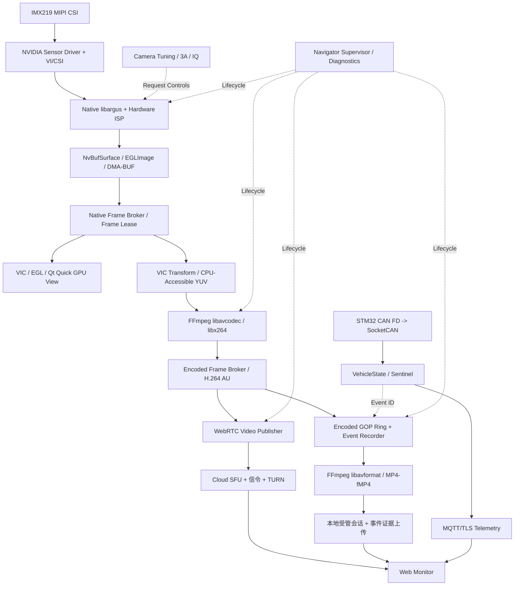

# cockpit-system Phase 1：车载 Camera / 视频 / 车辆状态 / 云端监控完整技术设计与开发计划

> **规划基线：2026-10-24**  
> 目标平台：Jetson Orin Nano 8GB / Ubuntu 22.04 / Jetson Linux R36.x（以目标机 `cat /etc/nv_tegra_release` 等结果锁定） / IMX219 / Linux / C++17。  
> 项目仓库：<https://github.com/shanjiancaofu/cockpit-system>。  
> 本文是**计划与验收合同**，并不声称所有模块已经落地；凡标为“新建/改造”的内容均须实施并在真机验证。  
> 参考：JetCam Guardian、mmproject-imx6ull、AIPC；吸取设计，**不照搬 Rockchip 专用 SDK 或未验证的示例实现**。

## 0. 不再改变的决策

1. **正式 Camera 主链路唯一**：IMX219 → Native `libargus` → NVIDIA Hardware ISP → `NvBufSurface`（根据平台 API 使用 EGLImage / DMA-BUF / BufferOutputStream/EGLStream）→ Native Frame Broker → Qt GPU 预览 / H.264 编码 / 诊断。一个物理 Camera Owner；启动时检查独占访问。
2. **Hardware ISP Tuning 只属于主链路**：使用 libargus 的公开控制接口完成 AE/AGC/AWB、曝光补偿/ROI/锁、抗频闪、降噪、锐化、饱和度、可用的 CCM/Tone Map 等。公开 API 不等于 NVIDIA 内部 ISP 深度标定文件的全部访问权限。支持度在目标机上逐项探测，不能假定 RGB Gain、LSC、DPC 和完整 ISP 算法都对外可调。
3. **Software ISP 是独立备选测试链路**：V4L2 MMAP → RAW10 → CPU/NEON Software ISP → RAW/图像导出与 Benchmark。只有测试模式可启用；不接主 Frame Broker、不接 H.264/WebRTC、**不接受生产 Tuning UI 控制**；与 Argus 互斥占用 IMX219。
4. **编码统一 H.264**：支持 720p30 和 1080p30 两种配置，使用 FFmpeg `libavcodec`/`libx264`；当前 Orin Nano 不具备 NVENC，必须实测 1080p30 多功能并发。**首版仅一个常驻编码分辨率**；需要“720p 实时 + 1080p 同时预录”时，应先对比云端转码与车端双编码的系统成本，不把两路软件编码默认常驻。
5. **实时 / 录像共享编码帧**：`EncodedFrameBroker` 输出一次 H.264 Access Unit，供 WebRTC 和事件录包共同消费。事件录像以带关键帧和时间戳的 GOP 环形缓存实现，视频文件交由 FFmpeg `libavformat` 封装。
6. **保留并扩展现有 Navigator、Recording、Vehicle、Sentinel**，不重复造总调度器和录像会话管理。
7. **本阶段不新增 VLA、ASR/LLM、ALSA、OTA 的实现**：已有代码不删除、保持构建兼容；仅预留未来 GPU Consumer / 语音音轨接口。CAN FD 只读状态；远端无任何绕过本地安全层的真实底盘控制。
8. **视频数据面不走 gRPC**：gRPC 或 Unix Socket 传控制消息和元数据，图像共享用 DMA-BUF FD + SCM_RIGHTS（可用性经目标机验证），编码数据用有限容量的本地 IPC；云端走 WebRTC 和 HTTPS / MQTT。

## 1. 项目范围与系统成果

| 产出 | 功能 | 本阶段定位 |
|---|---|---|
| Native Camera Runtime | 单设备管理、Capture Session、硬件缓冲、异常恢复 | P0 核心 |
| Camera Tuning | Argus 3A/IQ 查询、可用参数调节、实时可视化、Profile 与回滚 | P0 核心 |
| Native Frame Broker | Buffer Pool、Frame Lease、同步、时间戳、背压、跨进程 FD | P0 核心 |
| Qt Video Preview | GPU 原生纹理显示、摄像头状态、抓拍、延迟和画面质量诊断 | P0 |
| H.264 Encoder | 720p/1080p 档位、零延迟编码、动态码率与编码状态 | P0 |
| Encoded Frame Broker | 多路订阅、关键帧感知、有界队列、代际隔离 | P0 |
| Event Video Recorder | 触发前后录制、索引、文件完整性、断电恢复 | P1 |
| WebRTC Video Only | 本地端到云端或浏览器视频通道，ICE/DTLS-SRTP，重连 | P1 |
| Vehicle Telemetry | SocketCAN → VehicleState → MQTT/TLS → Dashboard | P1 |
| Web Monitoring / Cloud | 实时视频、车况、告警、录像浏览与下载、权限 | P1/P2 |
| Camera Diagnostics | 传感器探测、RAW/Test Pattern、压力测试、故障注入、证据报告 | 横向质量工程 |
| Software ISP Lab | 单独工具入口、继续维护旧 NEON/RAW 成果 | 保留但不扩入正式路径 |

### 1.1 生产数据图



**测试旁路（互斥，不连接上述生产图）**：`IMX219 → V4L2 MMAP RAW10 → Software ISP (NEON) → RAW/BGRx 导出 + Benchmark + 比较报告`。

**可选 GStreamer 适配**：只用作独立基线、USB 摄像头兼容或未来特定协议插件；主要 Camera Producer 不以 `nvarguscamerasrc` 为产品依赖。NVMM 是 NVIDIA GStreamer 内存抽象，DMA-BUF 是 Linux 共享机制，不能简单认为二者性能必有高低。

## 2. 当前代码资产与迁移原则

截至本次读取默认分支，仓库 README 可确认：

- 已有 `argus_isp / uvc / software_isp / synthetic` 后端和 `CameraPreviewSource` 预览接口；Argus 生产预览当前走 `gstreamer_preview_pipeline.cc`，输出 BGRx 并进入 POSIX Shared Memory 双缓冲。
- `camera_frame.h` 已定义 `source_timestamp_ns / source_clock / received_at_ns`；要**沿用时间语义并升级成 NativeFrame 元数据**，不要抛弃既有时钟映射成果。
- Software ISP RAW10 + NEON/CPU 含 BLC/WB/Demosaic/Gamma，有独立性能基线。隔离为诊断与测试用途，不为其建立新的 Tuning 服务。
- 已有 `cockpit/modules/recording/`：临时会话目录、manifest、vehicle_state.jsonl、events.jsonl、data_files.jsonl、校验、原子 COMPLETE、异常恢复、清理策略。**视频录包作为该会话模块的新 artifact 类型，不建立平行的录像数据库**。
- 已有 Navigator 进程监督；车辆 gRPC、Sentinel 事件处理、SocketCAN/STM32 状态和部分硬件链路测试。优先复用；生产遥控真实底盘仍关闭。

**迁移策略**：以新的 `NativeCameraSource` + `NativeFrame` 为目标，在切换前保留现有 Argus/GStreamer 路径作 A/B benchmark 和回退；切换并实测后才移除冗余业务数据路径。现有 `CameraFrame` 与 gRPC API 暂保留兼容适配器，不以 BGRx 作为全系统标准帧格式。

## 3. Camera Native Capture 详细设计

### 3.1 初始化与设备能力

`CameraOwner` 唯一打开 Sensor，枚举 Camera Device/Mode/帧率/可用 Exposure/Gain Range/3A Controls/颜色与输出格式，生成只读 `CameraCapabilities`；锁定 sensor-id、输出模式与 BSP/内核版本，并拒绝不可满足配置。

主路径优先研究 libargus `STREAM_TYPE_BUFFER` + application-managed `EGLImage`，必要时使用官方维护良好的 EGLStream Producer/Consumer 路径。`NvBufSurface` 与 DMA-BUF FD 的导出、导入、格式、plane layout、cache sync 在目标 BSP 逐项验证；**不是任意 FD 都可以给 Argus 直接填充**。

### 3.2 状态机

`UNINITIALIZED → DISCOVERED → CONFIGURED → RUNNING → DRAINING → STOPPED`；异常则进入 `FAULTED → BACKOFF → REBUILDING → RUNNING`。停止顺序：停止接受新订阅 → 停止 repeating capture → 结束输入帧 → 等待租约释放或到期隔离 → 停止编码 → finalize 录像 → 释放 Camera Session 和 Native Buffer。超时不得在消费者仍持有硬件对象时强制复用原缓冲。

同一物理 Sensor 的 Argus 主模式和 V4L2 RAW 测试模式必须通过统一 Device Lock 互斥；Camera crash / `nvargus-daemon` 异常恢复需要单独验证，不能把重启守护进程当作通用无损恢复。

### 3.3 Buffer / Frame 生命周期

- `NativeFrame`：sequence、capture_generation、sensor timestamp、clock domain、monotonic anchor、receive timestamp、width/height/fourcc、plane strides/offsets、layout/modifier、colorimetry、rotation/crop、原生 handle、Fence/同步字段、Tuning Profile ID；metadata 与大幅像素分离。
- `FramePool`：预分配有限个兼容 NvBufSurface，记录 Slot ID、generation 和 inflight lease count；不要每帧 new/delete。
- `FrameLease`：RAII 引用；同进程用对象租约；跨进程传输 DMA-BUF FD（`SCM_RIGHTS`）后需要租约 token/ack/lease timeout/进程死亡回收。**接收端必须已释放资源才能重新复用 Slot**。
- `FrameBroker`：Capture 回调只做轻量分发；预览 latest-only；编码 ingress 有界，不阻塞采集；诊断可采样保存，不参与高速主路径。
- GPU 同步：明确生产者完成、VIC 完成与 EGL/Qt 渲染完成的同步点；CPU map 时按 NvBufSurface 的同步要求处理。对每处复制、格式转换、Fence wait 埋点。

### 3.4 时间戳原则

记录原始 sensor timestamp 及**时钟域**；同一时钟域才可直接相减。将单调时钟用于队列与延迟计算，wall clock 仅用于录像事件展示和上传。与 SocketCAN 接收时间建立 host monotonic 对应关系，保留 STM32 本地 timestamp/sequence/重启计数；不能把 host receive time 冒充原始曝光时刻。编码层定义显式 `time_base`、PTS/DTS 和帧丢弃标记。

## 4. Hardware ISP Tuning：只控制 Argus 主链路

### 4.1 控制接口（必须做 Capability Gating）

- `IAutoControlSettings`：AE Lock / AWB Mode / AWB Lock / AE-AWB Regions / 曝光补偿 / Anti-banding（以实际 API 支持为准）。
- `ISourceSettings`：曝光时间范围、Sensor Gain、Frame Duration（手动曝光采用固定/窄区间并核对实际生效帧）；AF 仅限有可控镜头硬件时出现。
- `IDenoiseSettings`、`IEdgeEnhanceSettings`、部分 CCM、Tone Map、饱和度等开放接口。
- `ICaptureMetadata`：**读回实际曝光时间、Sensor Analog Gain、ISP Digital Gain、Sensor Timestamp、统计信息**，区分“请求值”和“实际生效值”。不同控制可能存在多帧生效延迟。

**明确不承诺**：通过 libargus 就能手写 NVIDIA 内部 AE/AWB 算法、随意修改 RGB gains、镜头校正表 LSC、DPC、全部 ISP calibration；必要时对接 NVIDIA 官方/合作伙伴 ISP tuning 工具，或仅以公开 3A/IQ 控制和后级颜色处理作为可交付范围。Software ISP 不由这个服务管。

### 4.2 Tuning Service 与 UI

`CameraTuningService` 实现：`GetCapabilities`、`GetRequestedControls`、`GetEffectiveMetadata`、`PreviewChange`、`ApplyPatch`、`SaveProfile`、`ActivateProfile`、`RollbackProfile`；每次 patch 参数验证、revision compare-and-set、序列化到 Camera 控制线程，失败不提交；应用成功后异步读取 N 帧 Metadata 观察收敛并更新 effective 状态。

UI 建议多页：AE/AGC、AWB、防频闪、图像质量（NR / Edge Enhance / Saturation / CCM 能力探测）、直方图与 ROI、Profile A/B 对比、日志与恢复。可视化支持亮度直方图、RGB 统计、过曝/欠曝比例、灰卡/ColorChecker 测试图片导出；**指标区分硬件 ISP metadata 与后级图像分析**。

Profile 按 sensor ID + mode + BSP version + lens + schema version 版本化；默认/车内/逆光/弱光模式，JSON 或 YAML 可审计。权限默认仅本机管理员，远程调参需要额外鉴权、限速和回退。

### 4.3 独立 Sensor Diagnostics（借鉴 JetCam Guardian）

`camera-diag`: `--list-modes`、`--enumerate-controls`、`--save-raw`、`--test-pattern`、`--capture-count`、`--duration`、`--fault-inject`、`--snapshot`、`--report`；支持 V4L2 `VIDIOC_QUERYCAP/ENUM_FMT/REQBUFS/QBUF/DQBUF` 的正确错误处理；收集 VI/NVCSI/Argus 内核日志、fps、sequence gaps、buffer errors、timeouts。Test Pattern 如要修改 IMX219 驱动，按**精确 L4T 版本**重建、验证并保留内核回滚选项；不直接套用 R36.5 驱动补丁。

## 5. Qt GPU 预览与拍照

生产 Qt 预览不经 BGRx 系统内存主路径。使用兼容的平台图像 Buffer → EGLImage/GL Texture → Qt Quick（必须在正确的 Qt/图形线程维护 EGL context 和纹理生命周期）。实测 Qt RHI / EGL 后端兼容性；不兼容时暂用 VIC + CPU BGRx 作为明示的 fallback，并记录额外拷贝，不要伪称 GPU 零拷贝。

显示订阅 latest-only，有独立 frame deadline，UI 不能卡住 Capture。拍照提供两档：**预览帧 JPEG**（即时轻量）与**高质量独立 JPEG snapshot**（按设备能力）。抓拍以 Frame Lease 与 Metadata 绑定，不重新打开 IMX219。静态/动态文字 OSD 采用 Qt 显示叠加；**录制视频默认原始无 OSD，事件信息写 sidecar JSON**，必要时再做有版本控制的烧录叠加分支。

## 6. H.264 720p / 1080p 统一软件编码

### 6.1 基本链路

`NativeFrame NV12 → VIC 转为 CPU 可访问 pitch-linear NV12/I420 → AVFrame (带 PTS/stride) → FFmpeg libavcodec/libx264 → EncodedVideoFrame → Broker`。

Orin Nano **没有 NVENC**；NVIDIA 文档确认 CPU libx264 需要可访问的 pitch-linear 图像。对 block-linear 硬件缓冲转换/复制是必要成本，应该追求**避免多余拷贝**，而不是承诺端到端零拷贝。原生采集与 DMA-BUF 的收益在 GPU 预览、GPU 消费者和内存共享上更突出。

| 预设（初始测试，不是验收既成事实） | 720p30 | 1080p30 |
|---|---:|---:|
| 宽高 | 1280 × 720 | 1920 × 1080 |
| 目标 fps | 30 | 30，需真机确认并发达标 |
| 起始视频码率 | 2 Mbps | 4 Mbps |
| GOP | 30 帧，约 1s | 30 帧，约 1s |
| B frame | 首版 0（低延迟） | 首版 0 |
| x264 preset | veryfast / ultrafast 对比 | ultrafast / veryfast 对比 |
| H.264 Profile | 经浏览器兼容性验证后选择 | 同左 |

**档位是编码器配置，不是同时输出两路码流。** 切换分辨率/像素格式应经过 Encoder drain/re-create、通知 Broker 变更 codec config generation、发 IDR / SPS / PPS、录像正确切段与 WebRTC 重新协商（如有必要）。低带宽情况下优先限码率/帧率，必要时降 720p；若要**同时** 720p 实时且 1080p 原生事件预录，需双编码或分辨率分支，或固定 1080p 上传再由云端转 720p；没有免费的“一路同时产生两个分辨率”。

### 6.2 EncodedVideoFrame 契约

`codec=h264`、`generation`、`frame sequence`、`source mono timestamp`、`pts/dts/time_base`、`keyframe/idr`、`SPS/PPS/extradata version`、`width/height`、`encoder profile`、`bytes`，按完整 Access Unit 发布；不要在 API 层直接假设每个 `AVPacket` 永远就是一帧。

### 6.3 Encoder/Broker 背压

- Capture→Encoder：容量 2–4 帧，超过上限记录掉帧，必要时请求 IDR，保证最新画面优先。
- Encoder→WebRTC：容量按毫秒及字节双重限制；网络拥塞按关键帧依赖处理、丢弃到下个可解码 IDR，不能任意抛掉 P/B 帧后继续转发。
- Encoder→Recorder：GOP ring，按时间 + 字节预算严格有界；过载时标记录像缺口和失败状态，不靠无限队列堆内存。
- 网络/录像状态机不得回调 Camera Capture 线程做 IO 或等待网络。

## 7. Event Video Recorder：复用现有 Recording

### 7.1 模块分工

`EncodedGopRing` 保留压缩视频预录；`EventRecorder` 管事件窗口、预录选取、编码代际、IDR 边界、停止与事件合并；`Mp4Muxer` 通过 FFmpeg `libavformat` 封装，并写入现有 `recording` 会话作为 artifact。`VehicleState` 与 `Sentinel` 通过**现有 typed event** 触发，首版只有设备/规则事件，不声称 AI 风险识别。

### 7.2 事件策略

- 默认建议：pre-roll 5s，post-roll 10s，GOP 1s。实际文件起点从 `event_time - pre_roll` 之前最近可用的 IDR 开始，可能多保存约一 GOP，不能把非关键帧作为文件首帧。
- 每个事件有 `event_id`、severity、trigger source、host monotonic + wall timestamp、source Camera generation、CAN source ID 和状态摘要。
- 相邻事件合并/延长窗口，支持冷却和录像上限；硬盘空间不足时禁止新录并告警，不能拖死采集。
- 写临时片段（如 `.part`）→ flush/同步/封装完成 → 原子 rename → 更新现有 `data_files.jsonl/manifest` → 校验/索引。可评估短段 fMP4/MKV 提高异常掉电可恢复性；崩溃时的片段需通过 ffprobe 验证和 salvage，不是 `rename` 就保证绝对断电安全。
- 配置切换、相机重建、编码 generation 变化时强制分段，保持每段 codec extradata、PTS/DTS 自洽；历史元数据与视频建立可查询时间轴。

### 7.3 存储预算示例

以 1080p H.264 4 Mbps（只有视频负载）为例：15 秒约 `4e6 × 15 / 8 ≈ 7.5 MB`；加容器/元数据余量，建议以实际文件大小和剩余磁盘可用空间控制，不直接按固定事件数估算。5GB 上限、会话字节上限等优先沿用当前 Recording 配置。

## 8. 实时流媒体与云端

### 8.1 WebRTC 后端选择

选定一个 `WebRtcPublisher` C++ 抽象，优先 POC 对比：

- **原生 C++ WebRTC（如 libdatachannel + 自己的 H.264 RTP packetizer）**：更统一的进程与时间戳控制，但 SDP、RTP FU-A、SPS/PPS、RTCP 反馈、关键帧和拥塞处理必须完整测试。
- **GStreamer `appsrc + rtph264pay + webrtcbin`**：借用成熟媒体 RTP/WebRTC 基础设施，但从自研 Encoded Frame Broker 对接 GStreamer 内存与 pipeline 状态复杂度增加。

**首选架构**为原生 C++ Publisher（因为编码码流已在应用层）；以真实浏览器 Chrome/Firefox、局域网与跨 NAT 测试作为决定；如果无法可靠通过关键帧恢复和浏览器兼容验收，则落回 `webrtcbin` 实现，不重新引入 GStreamer Camera Producer。不能使用自写 WebSocket 冒充 WebRTC。

信令服务负责鉴权、SDP、ICE、重连、session generation；TURN/STUN 与 SFU 在公网环境有明确依赖。`WebRTC = ICE + DTLS-SRTP + RTP/RTCP`，单独 `WebSocket` 只是信令，不能承载所谓 WebRTC 视频数据面。

### 8.2 Cloud 最小架构

- `signaling/api`：HTTPS + WebSocket，设备 JWT/mTLS 或短期凭证；操作审计。
- `SFU`：消费车端上行并提供多观看者；不要求 Jetson 每开一个网页再编码或再上行。
- `MQTT Broker`：TLS 连接、车况状态消息 QoS 0、低频事件 QoS 1（应用去重）；断连后有限容量离线队列。
- `Backend/Storage`：受管事件、视频文件索引、下载/HTTP Range、对象存储签名 URL 和保留策略。
- `Web UI`：WebRTC 直播、CAN 状态、健康监控、事件录像、设备离线/恢复、视频档位状态。无人登录也不应拖死车端相机。

H.264 1080p 上行时，浏览器 CSS 缩到 720p 不降低流量。需要 720p 真正低带宽版本时，使用**云端转码**或车端切换单编码分辨率；前者会增加云端编码资源。自动码率调整必须结合 RTCP、丢包率、RTT、可用上行等指标验证。

## 9. Vehicle / CAN FD / MQTT 与安全边界

继续复用现有 `cockpit/drivers/socketcan`、typed `VehicleState`、`Sentinel`、`ChassisEvent` 与记录时间线。只把**经过校验和新鲜度判断**的只读车况/故障、设备健康、告警事件上报云端；状态 topic 可 coalesce/latest-only，重大告警带稳定 `event_id`。维持本地安全策略及远程诊断与控制权限分离。云端不暴露 CAN ID 任意发送入口，也不允许绕过 `ChassisSafetyAdapter` 进行真实底盘动作。

事件关联至少包含：`event_id`、`vehicle_id`、`capture_generation`、`CAN frame source sequence/timestamp`、`camera frame source timestamp`、`host mono / wall clock anchors`、`session_id` 和 `video time-range`。网络时间同步受限时要标注误差，不制造虚假的毫秒级绝对同步结论。

## 10. 进程组织与线程分工

不推荐为每个视频算法都开一个进程。沿用 Navigator：

1. `camera_driver / camera_runtime`（一个 Camera Owner 进程或已有 Camera 子进程）：Argus、Buffer Pool、Frame Broker、Tuning Control、VIC 与采集健康；不做网络 IO。
2. `video_service`（可作为 Camera Driver 的受控编码子模块；跨进程优先选择原生 frame FD IPC，经实测决定进程边界）：x264 Encoder + Encoded Broker + Video IPC。编码崩溃不应无限次带着 Camera 重启；要具备短暂停机恢复路径。
3. `streaming_service`：WebRTC 信令会话连接与网络发送（只消费编码帧，独立背压）。
4. `recording_service`：扩展现有 `cockpit/library/recording` 的消费端和 MP4 封装；复用会话索引和 Sentinel 触发。
5. `vehicle_service + telemetry_service`：复用车辆状态，MQTT 上报与重连独立于 Camera。
6. `Qt HMI / Tuning Console`：只消费 Native Preview 或 UI metadata；绝不持有未释放的硬件 Buffer 无期限等待。

Navigator 负责模块状态机、超时、重启次数预算、退避、健康检查与**generation**；camera→encoder→streamer/recorder 是具名有向依赖，重建必须先完成旧资源清理，避免 Argus outstanding buffers 和分代串流。

## 11. 目录与关键接口规划（尊重已有仓库层次）

以下新增路径是设计建议，非当前已存在：

```text
cockpit/
  drivers/
    camera/argus/               # NEW: argus_device, capture_session, native_output
    v4l2/                      # EXISTING: RAW diagnostic capture
  core/
    video/                     # NEW: frame_info, dma_buffer, frame_pool,
                               #      frame_lease, fence, timestamp, plane_layout
  modules/
    camera/
      capture/                  # EXISTING -> Native Argus + legacy GStreamer adapter
      tuning/                   # NEW: capability, control, metadata, profiles
      transform/                # NEW: VIC / EGL / Qt texture adapter
      diagnostics/              # NEW: sensor mode, RAW, test pattern, capture probes
      isp/                      # EXISTING Software ISP, isolated test backend
    video/                      # NEW
      encoder/                  #       libavcodec/libx264
      frames/                   #       encoded_video_frame + H264 parsing
      broker/                   #       keyed queues / generation
      streaming/                #       WebRTC native backend or webrtcbin adapter
      recording/                #       encoded GOP ring and muxer adapter
    recording/                  # EXISTING session/manifest/index/artifacts
    vehicle/                    # EXISTING
  library/
    driver/camera/              # EXISTING: runtime and gRPC, enhanced
    recording/                  # EXISTING: bind Encoded GOP + events
    streaming/                  # NEW: publisher runtime if needed
    telemetry/                  # NEW: MQTT service if needed
  navigator/                    # EXISTING: orchestration
  apps/cockpit-ui/              # EXISTING: preview + tuning entry
  core/ipc/                    # EXISTING: gRPC + shm; add fd transport adapter
configs/                        # NEW camera/video/tuning/cloud sections
proto/                          # extend control and metadata contracts
scripts/tests/                  # NEW camera/video/recording stability gates
tools/                          # NEW camera-diag, camera-tune-ctl, video-probe
```

关键接口示例（表达架构合同，非可立即编译代码）：

```cpp
struct NativeFrameDesc {
    uint64_t capture_generation;
    uint64_t sequence;
    int64_t sensor_timestamp_ns;
    uint32_t clock_domain;
    uint32_t width, height, fourcc;
    // per-plane: fd/offset/stride/layout/modifier
    // sync/fence + color metadata + lease token
};
struct EncodedVideoFrame {
    uint64_t codec_generation;
    uint64_t source_sequence;
    int64_t pts, dts;
    AVRational time_base;
    bool is_keyframe;
    // Annex-B/AU framing contract + SPS/PPS version + byte storage
};
class IVideoEncoder { public:
    virtual ~IVideoEncoder() = default;
    virtual void Start(const EncoderConfig&) = 0;
    virtual void Submit(const CpuYuvFrame&) = 0;
    virtual void DrainAndStop() = 0;
};
```

如涉及发布给云端的接口，必须使用经过审查的版本化 Protobuf / JSON Schema，不将 Native FD 对象序列化到公网网络。

## 12. 推荐开发里程碑 / PR 顺序

| 阶段 / PR | 任务及明确交付 | 验收 Gate |
|---|---|---|
| PR-00 Baseline | 锁 JetPack/L4T/内核/IMX219 mode、现有 Argus/GStreamer FPS/RSS、RAW 基线；标记旧功能不回归 | 全部基线可重现，README 对应真实证据 |
| PR-01 Camera Diagnostics | V4L2/Media Controller/RAW 采集、Test Pattern 能力探测、`camera-diag`、异常报告 | 正常/故障模式、设备权限、超时和帧序号测试过关 |
| PR-02 Native Argus Spike | `libargus` Capture → EGLImage/NvBufSurface，验证 R36.x API、颜色格式、时间戳和 shutdown | ≥30 分钟真实 Camera 无挂起、无 buffer 泄漏；确认 BufferOutput/EGLStream 路线 |
| PR-03 Frame Pool/Broker | DMA-BUF FD IPC、Lease、Fence、跨进程死亡回收、代际隔离、Qt GPU View | Host fake + Jetson 真机验证共享和恢复，量化拷贝次数 |
| PR-04 Tuning | Argus Capabilities、3A/AE/AWB/AGC/NR/锐化、有效 metadata、Profile、Qt Tuning Console | 自动/手动/锁定/失败回滚、场景对比，Unsupported 控件正确禁用 |
| PR-05 x264 Encode | CPU YUV Bridge、FFmpeg Encoder、720p/1080p、SPS/PPS、PTS/DTS、码率统计 | 720p30 以及 1080p30 单编码性能基线，失败能安全降级 |
| PR-06 Encoded Broker | 同一视频帧并发分发、keyframe-aware queue、断流 IDR 恢复、订阅退出不阻塞 | 慢消费端/断连/关键帧缺失时无坏流蔓延 |
| PR-07 Video Recorder | 预录 5s + 后录 10s、CAN/Sentinel 触发、MP4 分段、manifest 复用、意外断电恢复 | ffprobe/ffmpeg 可解码，视频与事件时间线一致，限额与清理正确 |
| PR-08 WebRTC | Video-only Publisher、信令、ICE/STUN/TURN、SFU、浏览器多消费者 | LAN 与跨 NAT；断线/重连；RTT/P95/帧丢失等可观测 |
| PR-09 Telemetry + Cloud | MQTT/TLS、状态和事件、Dashboard、录像索引、文件上传 | 离线缓存有界、QoS 和去重、授权与下载权限测试 |
| PR-10 Hardening | Navigator 恢复、Argus crash、CPU overload、OOM、I/O 失败、fd/map泄漏、持续运行 | 2h 整合 + 24h 长稳的证据包；真实环境资源瓶颈/accepted risk 记录 |

**阶段依赖**：PR-00/01 → PR-02 → PR-03 → PR-04/05（可分工并行）→ PR-06 → PR-07/08 → PR-09 → PR-10。先让 Camera/ISP/Tuning 数据正确，再做编码；不用等全部 UI 做完再验证核心编码性能。

## 13. 最关键的验收标准

| 子系统 | 推荐目标（待实测） | 证明方式 |
|---|---|---|
| Native Argus 采集 | 1080p30 稳态；单 Sensor 独占；source timestamp 可信 | 帧序号、PTS 时间轴、摄像头 mode/clock 诊断 |
| 生产预览 | 不经全尺寸 BGRx CPU 往返为默认路径 | Nsight Systems、CPU memcpy 统计、VIC/EGL 日志 |
| 帧池 | 长稳无持续增长的 DMA-BUF FD、内存映射、未释放 lease | `/proc/<pid>/fd`、RSS、帧池计数与故障注入 |
| Tuning | 能力探测准确、有效参数可读回、失败可 rollback | 自动/手动、AE/AWB lock、Exposure/Gain 生效帧历史 |
| 编码 720p | 720p30 目标达成 | 解码帧率/PTS、x264 CPU/RSS/P95/P99、ffprobe |
| 编码 1080p | 1080p30 **目标**，须含 Preview 并发才算通过 | 压测和热稳定，不能仅凭 Argus 单独 FPS 宣称通过 |
| WebRTC | Video-only 可在真实浏览器播放、断网后安全恢复 | SDP/ICE、DTLS、关键帧重发、RTCP/丢包/延迟日志 |
| 事件录像 | 前 5s/后 10s 尽可能保存，帧头从 IDR 开始，分段可解码 | ffprobe + 断电/kill -9 + time alignment 验证 |
| 性能观测 | 各阶段 P50/P95/P99 和 `drop reason` | Source→VIC→encode→send/record 时序埋点 |
| 稳定性 | 分阶段 30min → 2h → 24h | 系统日志、温度、功耗、RSS、FD、健康和可复现脚本 |
| CAN | 仅可信读状态；超时/重启/乱序安全失效 | vcan、硬件读链、断联测试；真实下发保持禁用 |

性能数据命名一致：采集 FPS、处理 FPS、发送 FPS、客户端渲染 FPS 分别记载；不使用“稳定 30fps”混淆端到端指标。不要将单独 Argus 的 CPU ~28% 与 x264 编码并发预算直接相加作为硬件保证。

## 14. 测试矩阵和错误注入

1. **Sensor/Driver**：不存在设备、权限不足、错误 sensor-id、无支持 mode、VIDIOC 超时、模拟序列缺口/帧重复、异常退出重启、驱动 Test Pattern。
2. **Native Frame Pool**：双消费者持有、消费者 crash/不 ACK、FD 传递失败、Fence 超时、generation 变更、错 stride/modifier、CPU cache sync、资源耗尽。
3. **3A/Tuning**：AE auto/manual/lock、ROI 边界、防频闪、暗光/背光/荧光灯、参数超界、unsupported、保存和 rollback、热切换生效延迟。
4. **Encoder**：720/1080 切换、输入非连续 PTS、超载降帧、IDR 间隔、SPS/PPS 变化、异常 flush、码率与 VBV、长稳/热降频。
5. **Recorder**：预录边界前无关键帧、连续告警、切 profile、kill -9、磁盘写失败/满、缺文件、损坏索引、重建和 partial salvage。
6. **Network/Cloud**：浏览器慢消费、STUN/TURN 不可达、WiFi 掉线、局域网转公网、SFU 故障、token 过期、MQTT 重传去重、上传失败、HTTP Range 与越权测试。
7. **回归**：已有 Qt UI、VehicleState、Navigator、Sentinel、Recording，Software ISP Lab 仍可独立跑；但**不允许 lab 与正式 Argus 同时打开同一 Sensor**。

证据包每次记录：设备与固件版本、Git commit、构建参数、模式/码率、有效 Tuning Profile、fps/latency/CPU/RSS/功耗/温度、掉帧原因、录包 sample、sha256、原始日志和 PASS/FAIL 汇总；借鉴 JetCam Guardian 的可复现验收方式。

## 15. 安全、发布和运维

- 云端访问必须有设备身份、观看者权限、TLS、WebRTC DTLS-SRTP、录像文件授权；生产接口不可默认匿名访问；Web UI 与 Tuning API 分权。
- 不通过公网暴露任意 `camera set-reg`、`/dev/video*`、Unix Socket 或 CAN 帧发送；Tuning 仅允许有审计的有限参数。
- 所有高频数据队列按帧数/字节数/时延设上限，避免 8GB RAM 被积压吞噬。
- 日志避免打印私钥和个人信息；事件录像设可配置保留期和访问审计。设备离线时依赖本地磁盘限额 + 有界消息队列。
- 构建固定 CMake/GCC、Jetson ABI、FFmpeg/libx264 与 JetPack 版本；x86_64 mock/单测和 ARM64 实机分开。沿用仓库现有 `scripts/build.sh`、CTest、Sanitizers、Navigator stability 流程。
- 现有 safe-ota 代码保持原样，本阶段**不新增升级机制**，但发布回滚与可启动的系统备份是驱动试验的前置要求。

## 16. 参考实现（借鉴而非依赖）

| 来源 | 借鉴点 | 不照搬项 |
|---|---|---|
| <https://github.com/kings669/jetcam-guardian> | V4L2 Test Pattern、Sensor/Driver 诊断、RAW60 和视频长稳日志、SHA256 证据包、Argus orderly shutdown | GStreamer NVMM→CPU I420→x264 的全部数据架构、R36.5 驱动补丁直接复用 |
| <https://github.com/guomin-w/mmproject-imx6ull> | Qt Capture Worker、解码和媒体队列职责分离 | 无界队列、每帧 QByteArray 拷贝、对错误处理不完整的 V4L2 Demo |
| <https://github.com/haoyn231/aipc> | 独占媒体硬件 Worker、进程监督/generation、关键帧感知队列、Last-good 回退、WebRTC/RTSP/MP4 管理 | Rockchip ISP/VPSS/VENC/RGN SDK、AI 推理功能、Rust 全盘重写 |
| NVIDIA Jetson docs | libargus、Native Buffer/EGL、NvBufSurface/VIC、Orin Nano software encoding 官方示例 | “Native == 零拷贝”和“随意修改 ISP 内部 tuning”的错误假设 |

参考官方：
- <https://docs.nvidia.com/jetson/archives/r36.4/DeveloperGuide/SD/Multimedia/SoftwareEncodeInOrinNano.html>
- <https://docs.nvidia.com/jetson/archives/r36.4/ApiReference/namespaceArgus.html>
- <https://docs.nvidia.com/jetson/archives/r36.4.3/ApiReference/Settings_8h_source.html>
- <https://docs.nvidia.com/jetson/archives/r36.5/DeveloperGuide/SD/CameraDevelopment/CameraSoftwareDevelopmentSolution.html>

## 17. 最短实现路径与明确终点

**先做可验证的纵向闭环**：`IMX219 → Native libargus → NvBufSurface → frame lease → VIC + CPU YUV → libx264 → Encoded AU → 本地 MP4`，确保 720p30 和 1080p30 的性能数据真实可信。与此同时建设独立的 Argus Tuning Control + Metadata 与 `camera-diag`。之后将 Encoded AU 供给现有 Recording、WebRTC，再扩展云端和 Vehicle 事件联动。

**第一阶段完成定义**：用户可选择 720p/1080p 单码流，在本机 Qt 看到低延迟预览；通过有权限的 Tuning Console 控制 Hardware ISP 并看到实际生效 metadata；能在 Web 页面观看车端 H.264 实时视频和车辆状态；CAN/Sentinel 告警生成带事件前后视频的可解码录像；Camera crash、断网、磁盘满、消费者变慢不会让系统无限占用内存或泄露 DMA-BUF；有多轮稳定性和可追溯证据。Software ISP 测试独立保留但不影响主运行时。

> **范围说明**：VLA/推理/ALSA/OTA 均不在这个阶段的验收要求中；现有代码保持兼容，之后另开阶段评审。
